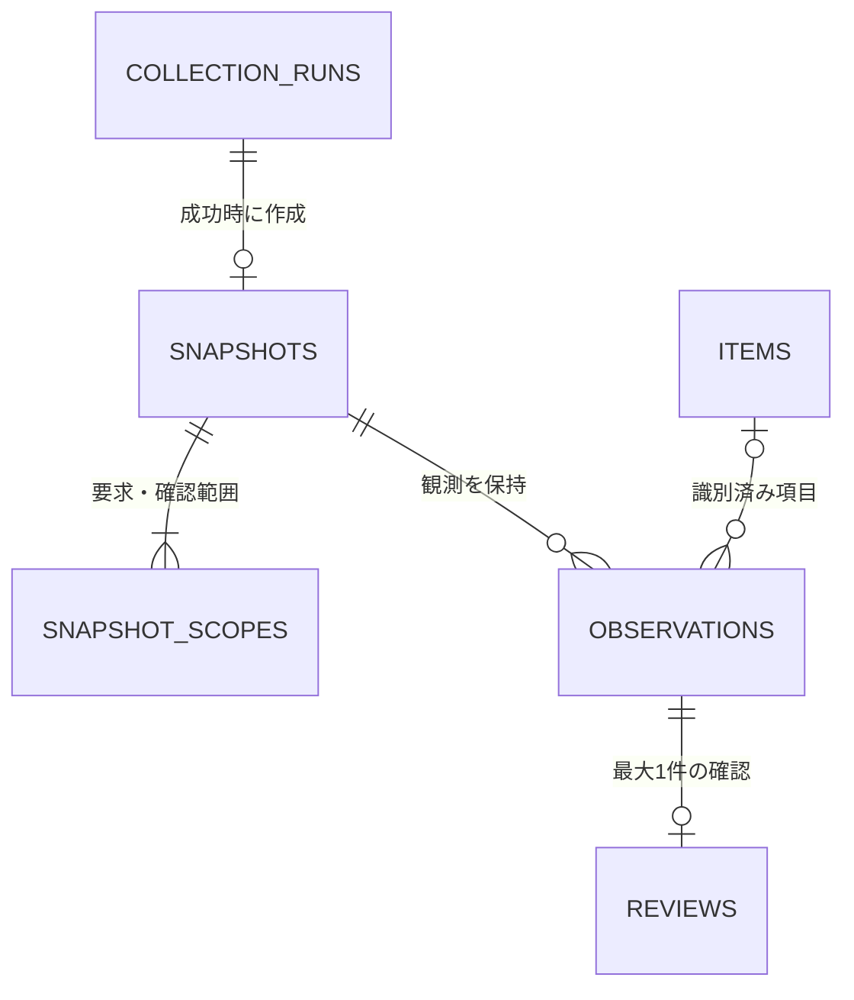

# データベース設計（案）

作成日：2026-11-14

## 目的と状態

本書はMVPの論理スキーマ、整合性、権限、トランザクション方針を定める。PostgreSQL 18でマイグレーションを追加し、ローカル`sm_secure` DBの`public`スキーマに適用済み。制約・ロール権限のDBスモークテストは実施済みだが、アプリケーション接続とログインロールでの統合テストは未実施。収集カテゴリが未確定のため、項目キーの生成・正規化規則とカテゴリ固有列は確定していない。

データベースは試行の失敗や不完全な取得を成功データと混同せず、後から比較根拠を確認できることを優先する。生出力を保存せず、引数は既定で保存しない。

## エンティティと関係

| テーブル | 1レコードが表すもの・主な属性 | 制約・注意 |
|---|---|---|
| `collection_runs` | 利用者が起動した1回の収集処理（1試行）。`started_at`、`finished_at`、状態、安全なエラーコード、取得プロファイル・対象スコープ・実行条件を持つ。 | 条件は既知／利用不可状態を含むJSONBでCHECK検証する。状態は実行中・成功・失敗・タイムアウト・解析失敗・中断を区別。生出力、引数、秘密値をエラー詳細に含めない。 |
| `snapshots` | 成功した1試行から確定した1つの保存済みスナップショット。`collection_run_id`、`created_at`、比較互換条件、引数保存方針を持つ。互換条件はツール・解析・識別ルール版を含む。 | `collection_run_id`は必須かつ一意。失敗試行にスナップショットを作らない。試行条件との一致と成功状態を遅延制約トリガーで確認する。 |
| `snapshot_scopes` | 1スナップショット内の1つのscope IDに対する要求有無と取得結果を表す。`requested`、状態、機密値を含まない理由コードを持つ。 | `(snapshot_id, scope_id)`を一意にする。要求カテゴリ集合とプロファイルの同一性を分ける。空結果と取得失敗・部分取得を区別する。具体的なscope IDは検証後に定義する。 |
| `items` | 検証済み識別ルール版と不透明な識別キーで追跡する1つの論理項目。 | `(identity_rule_version, identity_key)`を一意にする。キーの生成・正規化規則はカテゴリ検証後に決める。コマンド引数をキーに使わない。 |
| `observations` | 1スナップショットで得られた1つの出力行（1観測）。値と各値の取得状態・理由をJSONBで保持し、対応する`item_id`は未解決の場合がある。 | JSONBのキー・状態・値の組み合わせをCHECK関数で検証する。`snapshot_id`は必須。項目未解決時は`item_id`をNULLとし、未解決理由を保存する。同一項目の重複観測も上書き・統合しない。引数保存方針はトリガーで確認する。 |
| `reviews` | 1つの観測に対する1回の確認記録。確認日時と任意メモを持つ。 | `observation_id`は必須かつ一意。観測をまたいで移動せず、通常操作で更新・削除しない。 |

`observations`の識別済み項目参照は任意で、同じ項目への複数観測を許す。スナップショット内の重複を黙って消さないため、`(snapshot_id, item_id)`の一意制約は置かない。外部キーは履歴を保護する削除制限を基本とし、カスケード削除は行わない。

Domain型とテーブルの対応は[Domainモデル一覧](./domain-model.md#domainとdbの対応)にまとめる。比較結果は観測から導出し、独立したテーブルには保存しない。

## 値・状態の整合性

- 取得値は「既知」または「利用不可」として保存する。既知なら値は非NULL、利用不可なら値はNULLで理由を必須にする。空文字列は既知の値として扱う。
- 観測できなかった理由（未試行、取得失敗、欠損、解析不能、ポリシーによる非保存など）を区別し、未知を既知の空値に変換しない。
- スナップショットの引数保存方針と観測ごとの保存状態を整合させる。保存方針が無効なら、取得状態にかかわらず引数値はNULL。方針が有効で取得済みなら空文字列を含め非NULL、取得失敗ならNULLとする。
- 引数保存が有効な場合は、毎回の明示的な対話承認を収集開始前に得る。非対話実行では拒否し、未試行の引数を完了済み観測として保存しない。
- 既知の項目IDがない場合でも観測は保存できる。未解決理由と確認できたスコープを記録し、追加・削除の根拠には使わない。

具体的な状態列、値列、CHECK制約の分割はDDL作成時に定め、制約テストで検証する。アプリケーションの型だけを整合性の保証にしない。

## 状態遷移とトランザクション

1. 収集CLIは専用DB接続を開き、セッションレベルのアドバイザリロックを取得する。取得できなければ後続処理を開始せず終了する。
2. ロック保持後、残存する実行中試行を中断として確定し、新しい`collection_runs`を実行中で記録する。試行IDをCLIに返す。
3. 収集・解析の失敗時は安全なエラーコードと終了時刻を記録し、成功スナップショットを作成しない。DB障害で失敗状態を記録できない場合も、CLIで明示的に失敗終了する。
4. 成功時はロックを保持する**同じ接続**でトランザクションを開始し、スナップショット、範囲、項目、観測、試行成功状態をまとめて保存・コミットする。
5. 保存失敗時はロールバック後、可能なら失敗状態を記録する。接続喪失時は子プロセスを停止し、成功確定を続けない。コミット結果が不明なら成功と報告せず、試行IDで後から確認できるようにする。

収集用接続のロック競合、ロック喪失とコミットの競合、DB接続断、ロールバック後の失敗記録、コミット応答断をPostgreSQL統合テストで確認する。アドバイザリロックは接続プールをまたいで保持しない。

## DBロールとアクセス

| ロール | 用途 | 許可の基本方針 |
|---|---|---|
| `sm_secure_migrator` | スキーマ所有者・マイグレーション用グループロール | `NOLOGIN`。通常接続には使用せず、管理者がマイグレーションを適用する。 |
| `sm_secure_collector` | 試行、スナップショット、範囲、項目、観測の記録 | `NOLOGIN`。現行権限は必要な挿入と試行状態更新だけ。観測の更新・削除は不可。 |
| `sm_secure_web` | 履歴・比較の読み取りと確認記録の作成 | `NOLOGIN`。読み取りと`reviews`の挿入のみ。観測、項目、試行、スナップショットの変更・削除は不可。 |

初期マイグレーションはロールを作成する権限が必要なため、`DATABASE_URL`の管理者接続で適用する。現在の`.env.local`の接続ユーザーはスーパーユーザーであり、**アプリケーションの通常接続には使用しない**。各グループロールに対応するログインロールとパスワードは未作成で、DB統合テスト前に安全なローカル設定を行う。通常利用でスーパーユーザーや所有者権限を使わない。

## 実装前に決めること

- DBサーバーのバージョン、接続権限、ローカル初期化とマイグレーションの手順。
- カテゴリごとの識別ルール、`items`の一意キー、ルールバージョン変更時の互換性。
- `snapshot_scopes`で要求・確認範囲とアクセス拒否・部分取得を表す具体的な列と状態集合。
- 日時のDB型、タイムゾーン方針、同時刻スナップショットの安定した順序。
- 引数保存を有効にするCLIの承認方法と、収集条件への記録形式。
- 保持期間、バックアップ・復元、通常運用でのデータ削除手順。

初期スキーマは`db/migrations/001_initial_schema.sql`、`public`スキーマへの移行は`db/migrations/002_move_objects_to_public.sql`。適用コマンドは`npm run db:migrate`、スモークテストは`npm run db:test`。両コマンドは`.env.local`の`DATABASE_URL`を読み、URL自体はログに出力しない。

上記の判断は[技術検証メモ](./technical-validation.md)の結果と照合して確定する。Domain概念と実装状況は[Domainモデル一覧](./domain-model.md)、実装順序とテストゲートは[実装計画](./implementation-plan.md)、画面・収集契機との関係は[シーケンス図](./sequence-diagram.md)を参照する。
