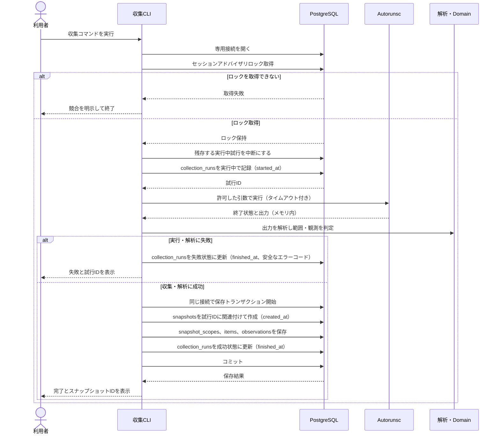
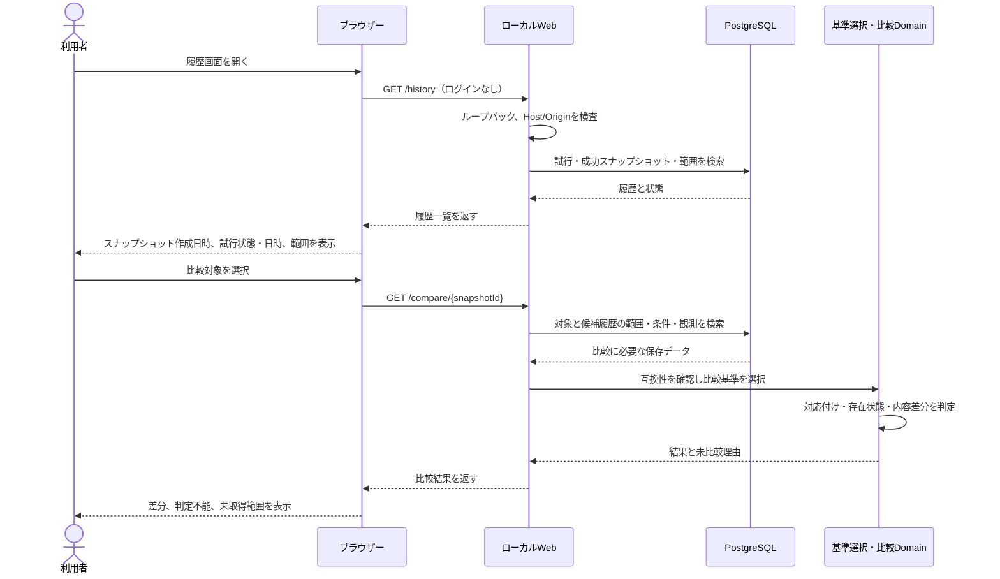
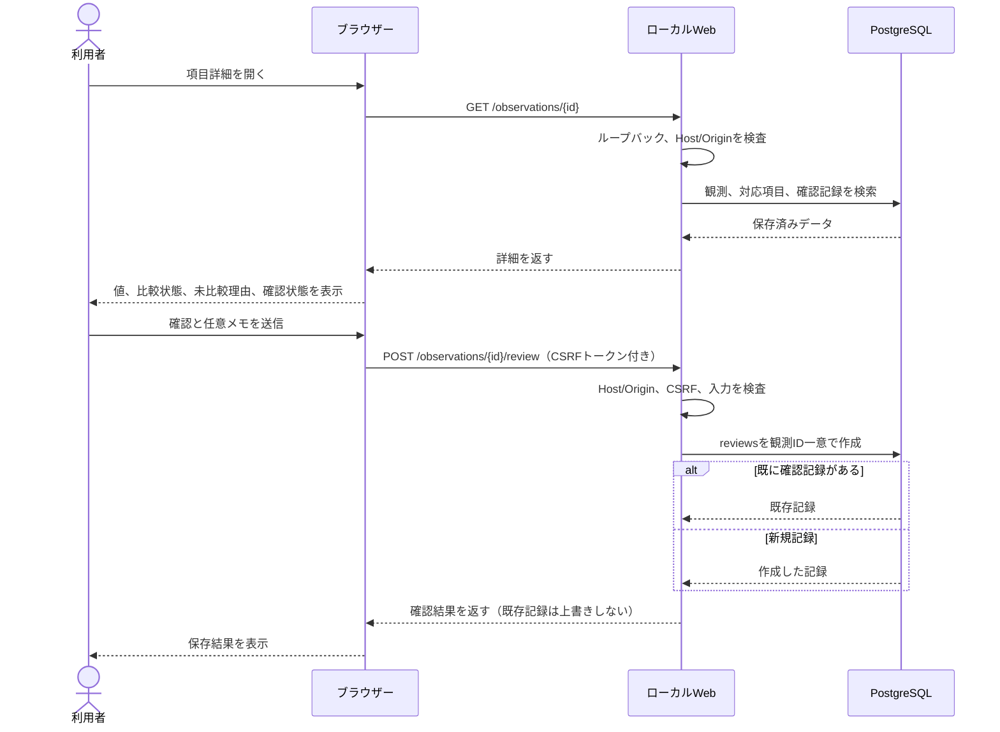

# 画面・DB・動作契機のシーケンス

作成日：2026-11-14

この図は実装目標を示す。CLI、DB、Web画面はいずれも未実装で、テーブル名と状態遷移は設計案である。Webはログインなしでループバックから利用し、収集はWeb画面から起動しない。

## 1. 収集とスナップショット保存

**動作契機:** 利用者がCLIで収集コマンドを実行する。履歴画面や比較画面を開いただけでは収集しない。

ロック保持接続を失った場合は子プロセスを停止し、成功として報告しない。保存失敗時はスナップショットを成功扱いせず、可能なら安全な失敗状態を記録する。生出力をログや一時ファイルに保存しない。

## 2. 履歴・比較画面

**動作契機:** 利用者が履歴画面を開く、または比較対象を選ぶ。画面表示ではDBを読み取るだけで、収集は起動しない。

比較基準がない場合は初回観測、互換性や存在の根拠がない場合は比較不能とする。異なる範囲を古い履歴で補わない。カテゴリ別の追加・削除表示は検証済み範囲に限る。

## 3. 項目詳細・確認記録

**動作契機:** 利用者が比較結果から項目を開く。確認記録は画面上の明示的な操作でのみ作成する。

## DB上の関係

- `collection_runs`は`started_at`、`finished_at`と試行状態を保持する。成功時に作られる`snapshots`は試行IDと`created_at`を保持する。
- `snapshots`は複数の`snapshot_scopes`と`observations`を持つ。
- `items`は検証済み識別子を持つ項目で、`observations`は項目に対応付けられない場合も理由付きで保存できる。
- `reviews`は一つの`observation`を参照し、観測IDにつき最大1件とする。
- 閲覧・比較は読み取り、確認操作は`reviews`の作成のみ。観測データの更新・削除は行わない。

関連資料: [機能一覧](./feature-list.md)、[実装計画](./implementation-plan.md)、[技術検証メモ](./technical-validation.md)。
